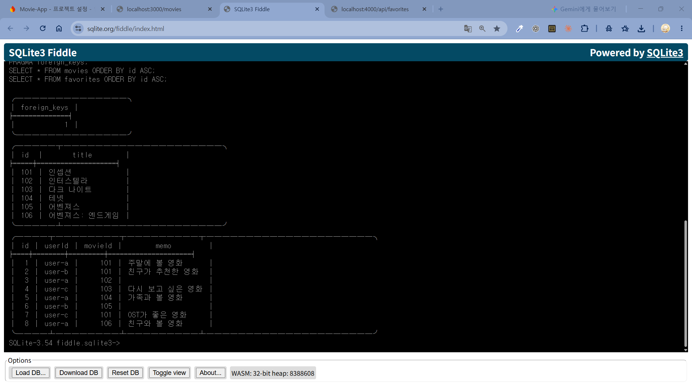
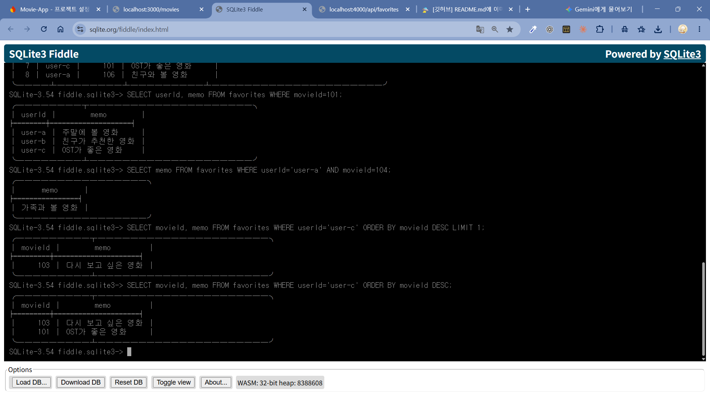
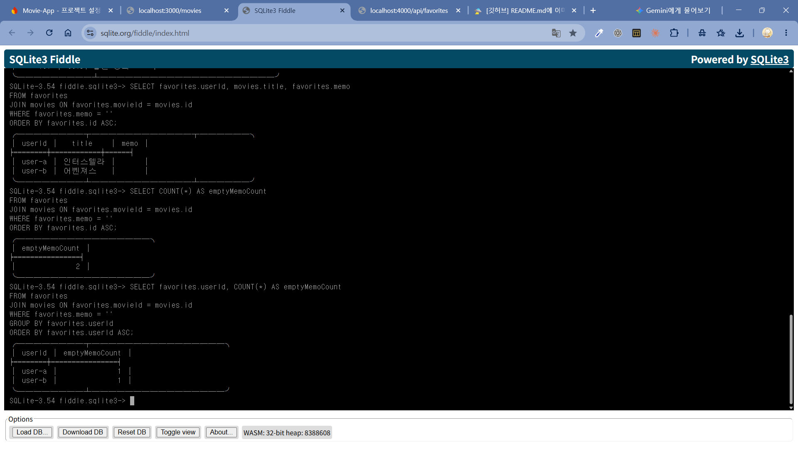
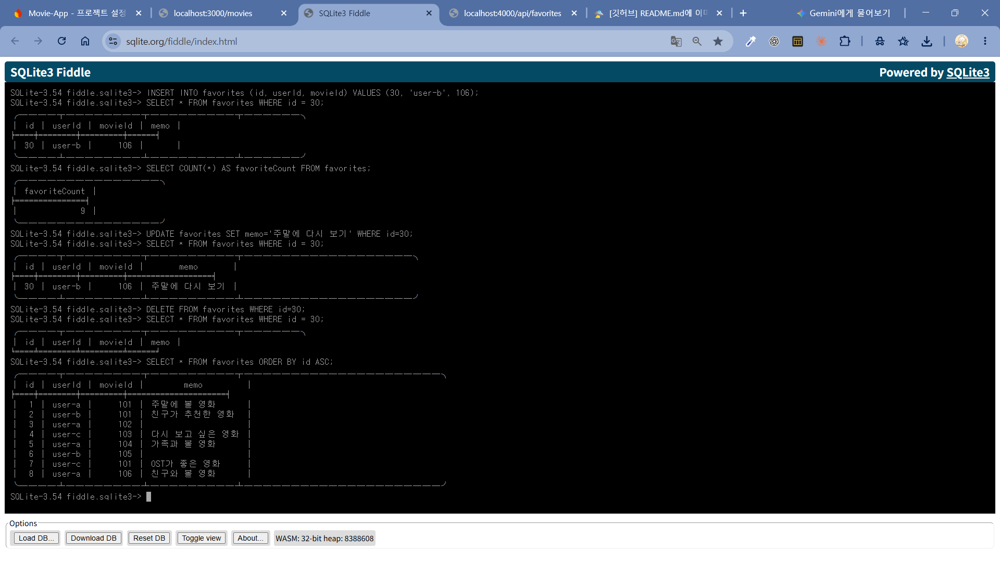
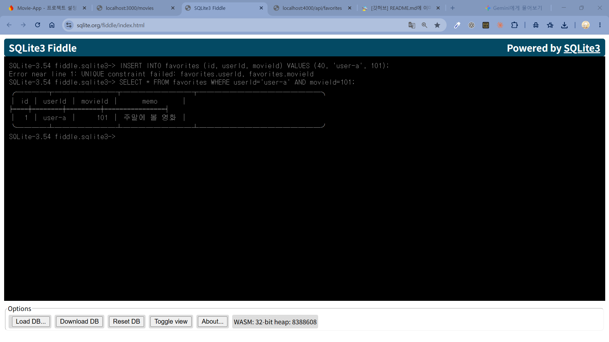
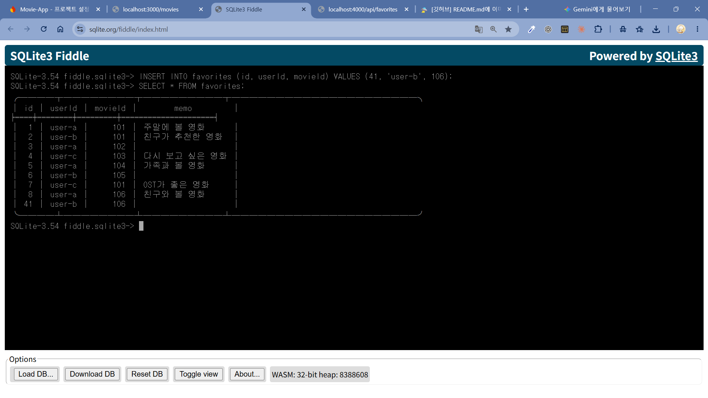
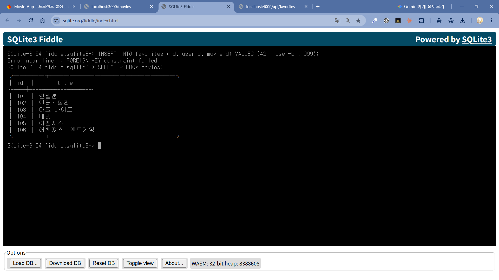
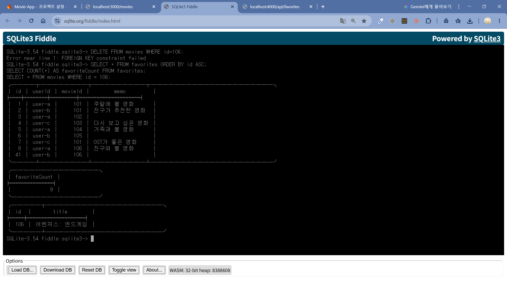
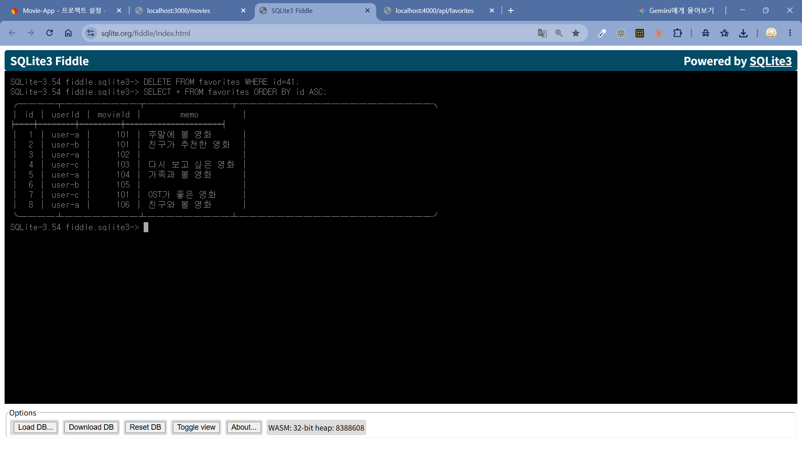

# SQL 실행 결과

실행 순서: 완성한 00-setup → 01-queries → 00-setup → 02-crud → 00-setup → 03-constraints.
각 항목에 실제 실행한 SQL과 실제 결과(텍스트 또는 캡처)를 첨부하세요.
예상 결과를 그대로 복사한 것만으로 실행을 확인할 수 없습니다.

## 준비: 외래 키 1 / 영화 6건 / 찜 8건

`sql/00-setup.sql` 전체 쿼리 실행

## 조건 조회 05·06·07·08

## 빈 메모 JOIN·전체 집계·사용자별 집계 14·15·16

## CRUD 09·10·11

> 추가: 9건 / 수정: id 30의 memo만 변경 / 삭제: 초기 8건 복원

## 제약조건 A·B·C·D

> 각 SQL, 성공/실패, 실제 오류 메시지, 이유를 기록하세요.
> D 직후 찜 9건과 영화 106 유지, 정리 후 초기 8건을 확인하세요.

### A

- SQL: `INSERT INTO favorites (id, userId, movieId) VALUES (40, 'user-a', 101);`
- 결과: 실패
- 오류 메시지: `Error near line 1: UNIQUE constraint failed: favorites.userId, favorites.movieId`
- 이유: TODO 12에서 설정한 UNIQUE 제약조건을 위배해 오류 발생. INSERT 시도한 쿼리와 동일한 `userId`값과 `movieId`값을 갖는 데이터가 이미 존재하기 떄문

### B

- SQL: `INSERT INTO favorites (id, userId, movieId) VALUES (41, 'user-b', 106);`
- 결과: 성공
- 오류 메시지: -
- 이유: TODO 12에서 설정한 UNIQUE 제약조건에 위배되지 않아 성공. INSERT 시도한 쿼리와 동일한 `userId`값과 `movieId`값을 갖는 기존 데이터가 없기 때문

### C

- SQL: `INSERT INTO favorites (id, userId, movieId) VALUES (42, 'user-b', 999);`
- 결과: 실패
- 오류 메시지: `Error near line 1: FOREIGN KEY constraint failed`
- 이유: TODO 13에서 설정한 외래키 제약조건을 위배해 오류 발생. INSERT 시도한 쿼리의 `movieId`값이 `movies` 테이블에 없는 `id`값이기 때문에 `favorites` 테이블에서 참조할 수 없음

### D

- SQL: `DELETE FROM movies WHERE id=106;`
- 결과: 실패
- 오류 메시지: `Error near line 1: FOREIGN KEY constraint failed`
- 이유: TODO 13에서 설정한 외래키 제약조건을 위배해 오류 발생. DELETE 시도한 쿼리의 `movieId`값을 참조하는 `favorites` 테이블 데이터가 존재하기 때문에 삭제할 수 없음

### 정리 후

